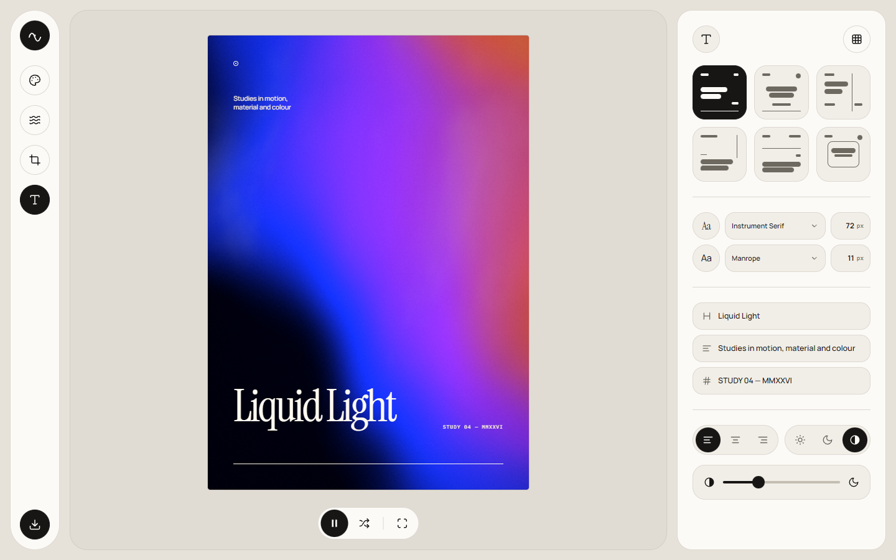
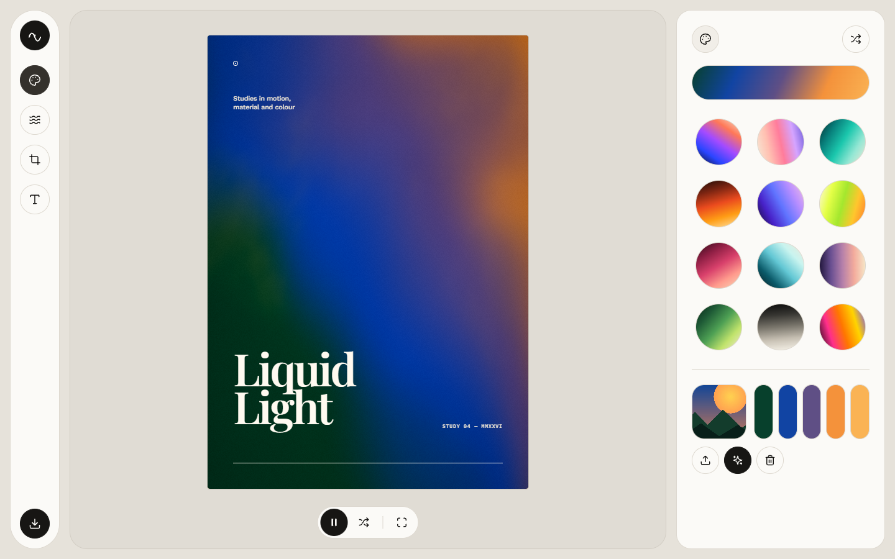
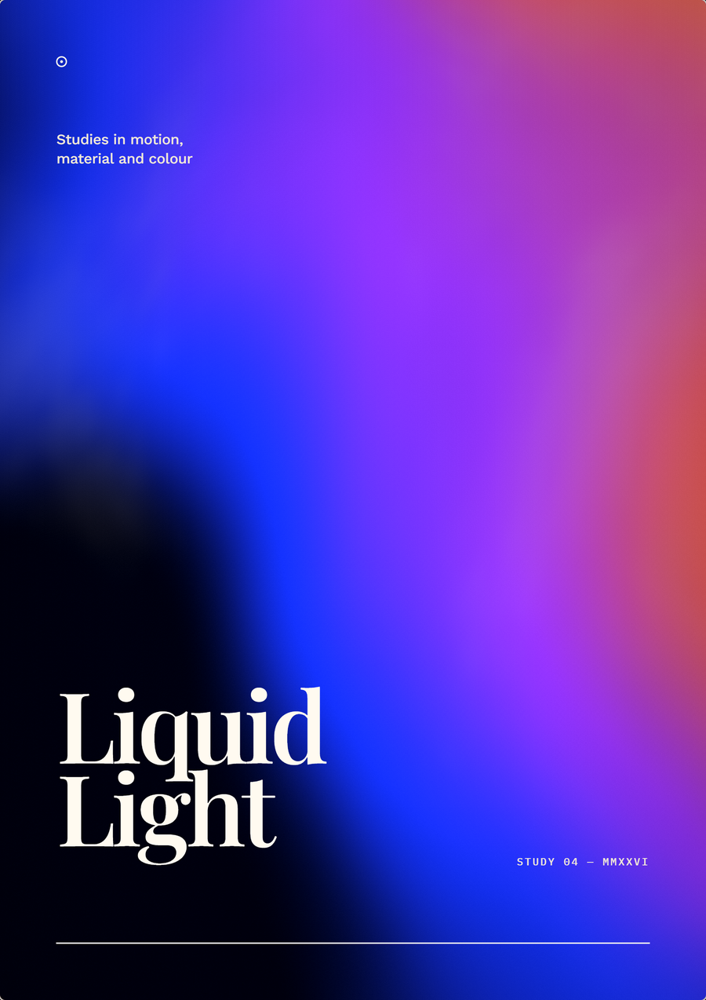

# Fluid — Poster Studio

An icon-led poster editor with a continuously moving WebGL fluid gradient. The
interface avoids explanatory copy: tools are represented by iconography, live
previews, and spatial grouping, with names reserved for the typography controls.



Image color extraction now lives inside the color panel:



PNG text is rasterized separately after webfont loading, so Google Font selections
survive in the exported file:



## Run

```bash
node server.mjs
```

Then open <http://127.0.0.1:4173>.

Any static file server works as well, for example:

```bash
python -m http.server 4173
```

A local server is recommended so that self-hosted assets and Google Fonts load with
normal web-origin permissions. Opening `index.html` directly can work for editing, but
some browsers restrict cross-origin webfont loading from `file://` URLs.

## Include

- Animated domain-warped fluid background rendered in WebGL: 6 motion presets,
  speed, warp, grain, and 12 color palettes.
- A4, 16:9, 4:3, 3:2, 5:4, and 1:1 formats with portrait/landscape orientation.
- Six editorial typography layouts with unique grids, live text editing, 20
  open-source typefaces (7 self-hosted plus 13 Google Fonts online) in named
  dropdowns, explicit pixel font sizes, alignment and auto/light/dark text contrast.
  The headline starts at **72 px**. Online families load dynamically from Google
  Fonts; self-hosted families keep the editor usable offline.
- Background darkening for readability (the requested contrast option; drop shadows
  are intentionally absent to respect the brief's no-shadow rule).
- Image import integrated into the color panel, with median-cut dominant-color
  extraction, source preview, extracted swatches, and automatic palette application.
- Optional 12-column layout guides, distraction-free preview, and high-resolution PNG
  export. Export captures backgrounds and CSS ornaments from the DOM, then rasterizes
  typography separately through Canvas after the selected webfonts have loaded, so
  custom fonts no longer fall back in the saved image.

All UI spacing uses a 4px rhythm, controls are circular or pill-shaped, and nested
rounded surfaces use concentric radii.

## Deploy to GitHub Pages

This is a static site with no build step, so GitHub Pages can serve the repository
root directly.

1. Create an empty public repository on GitHub.
2. Push this directory to its `main` branch.
3. Open **Settings → Pages**.
4. Set **Source** to **Deploy from a branch**, branch `main`, folder `/ (root)`, then
   save.

The published URL will be `https://<github-user>.github.io/<repository>/`.
All asset URLs in the app are relative, so project-site subpaths work without a
build configuration.

## Third-party licenses

See `LICENSES.md` and the license files in `vendor/`.
